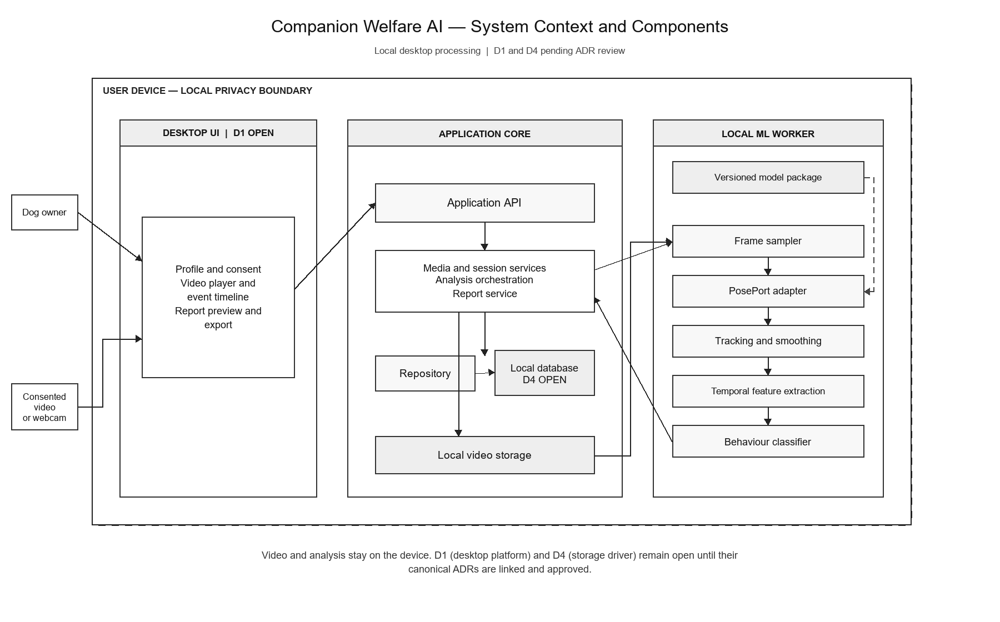

# System Architecture

## System context

Companion Welfare AI is a local desktop prototype for reviewing consented companion-dog video and displaying observable behaviour events. The dog owner imports a video (or optionally uses a webcam), reviews the analysis timeline, and previews or exports a report. The system is an observation aid; its output is not a diagnosis or a direct measurement of the dog's internal emotional state.

## Component view

Editable Mermaid source: [`diagrams/src/system-architecture.mmd`](../diagrams/src/system-architecture.mmd).

| Component | Responsibility | Requirement trace |
|---|---|---|
| Desktop UI | Profiles/consent, video review, event timeline, report preview/export | SYS-02, SYS-06 |
| Application API and core services | The UI entry point; media/session handling and analysis orchestration | SYS-02, SYS-03 |
| Repository and local database | Persist profiles, consent state, session metadata, and event records locally | SYS-04 |
| Local video folder | Keep imported video on the user's device and supply sampled frames to analysis | SYS-01 |
| Local ML worker | Sample frames; call a pose adapter; track/smooth keypoints; extract temporal features; classify observable events | SYS-03, SYS-05 |
| Versioned model package | Supply models to the worker through a validated local package | SYS-03 |
| Report service | Present results with timestamps, confidence, model version, and non-diagnostic notice | SYS-05, SYS-06 |

## Data flow and privacy boundary

1. The owner reviews consent and imports a video through the desktop UI.
2. The media service stores the session and video locally. The application API mediates UI requests; services access persisted data through the repository.
3. The orchestrator sends an analysis request to the separate local worker. The worker reads local frames and a verified model package, then returns event labels, intervals, confidence, and model version.
4. The core stores results locally and makes them available to the timeline and report service.
5. The user reviews, corrects, or exports the result. No external server is part of the depicted analysis flow.

The dashed privacy boundary in the diagram encloses the user-device components and local storage. External video input and a model package are shown as inputs; the diagram does not imply that user video or profile data is uploaded.

## Technology decision status

The current repository does not contain canonical ADR-0001 or ADR-0004 records. Therefore, this diagram intentionally identifies D1 (desktop platform) and D4 (local database/storage driver) as **decision open**. Any Tkinter/SQLite hello-world packaging spike is provisional, not evidence of team approval. See [`docs/adr/CWA-30-open-decisions.md`](adr/CWA-30-open-decisions.md). Do not treat those choices as accepted until the canonical ADRs are linked and approved.

## Requirement alignment

System-level constraints traced by the diagram are listed in [`docs/requirements.md`](requirements.md). The diagram is technology-neutral where the repository has no accepted ADR. Update the source and regenerate the PNG export after an agreed architecture decision changes a component or data flow.
